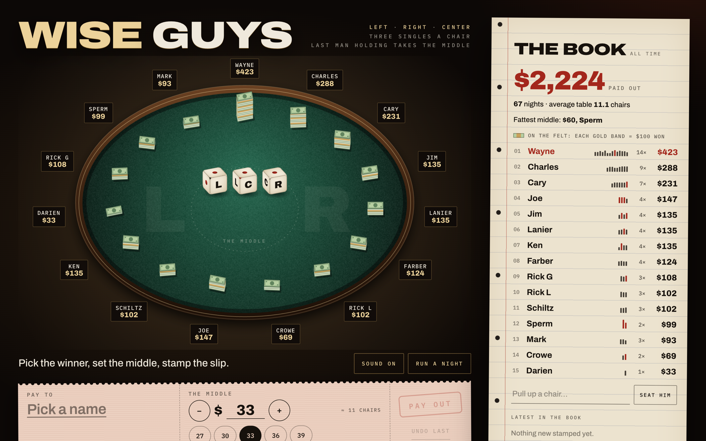
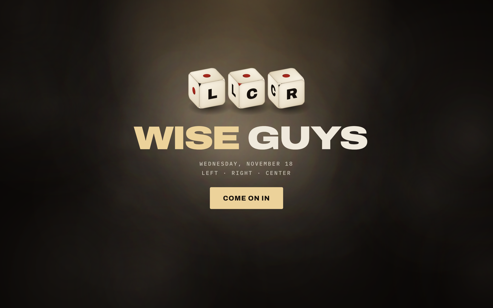
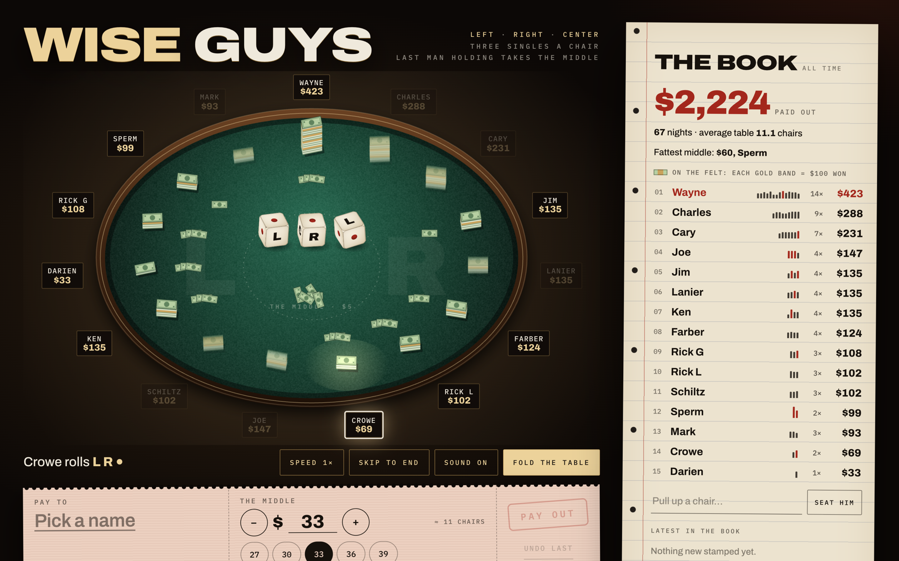
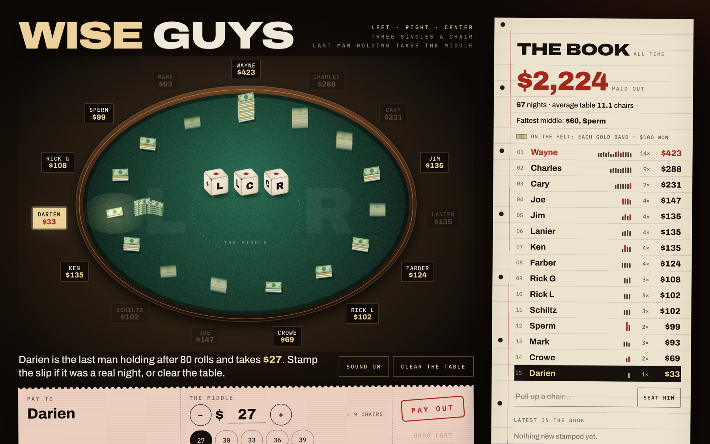
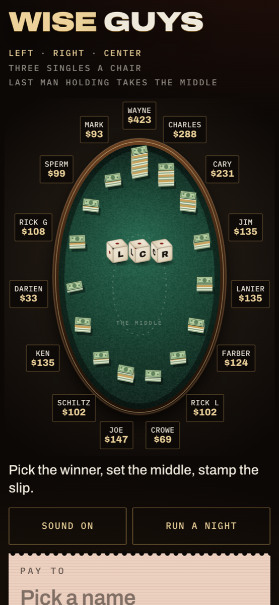

# Wise Guys · Left Right Center

My dad and his buddies play Left Right Center every Wednesday. They call themselves the Wise Guys. This is their scoreboard, rebuilt as a back room: a felt table, a chair for every player, and a paper book that keeps the all-time tally.

One HTML file. No build, no dependencies, works offline.

**Watch it run:** https://cap.so/s/h8zsn77952yh8gx

## What's in the room

**The way in.** Pool, shuffleboard, coffee, the calendar landing on Wednesday, then three dice through the smoke. Tap anywhere to skip.

**The table.** The scoreboard is the felt. Every player gets a chair, and their stack grows with what they've won. Each gold band on a stack is $100.

**A practice night.** Hit *Run a night* and the table plays a round of LRC with dice and flying singles until there's one man holding. Speed it up or skip to the end.

**The slip.** Pick the winner, set the middle, stamp it. Undo if the stamp was wrong.

**The book.** All-time paid out, nights played, fattest middle, and the ranked list with a little bar chart of each player's wins. *Copy the book* puts the whole thing on your clipboard.

**Phones first.** Built to be used at the table, so the tap targets are big and the layout stacks.

## Design notes

- Type is Archivo (wide, heavy) for the display and IBM Plex Mono for everything else. Falls back to Helvetica and Menlo offline.
- Colors are the room: dark walnut, brass, chalk, green felt, a pink carbon-copy slip, and a cream ledger with a red margin rule.
- The felt is a canvas. Stacks, the middle, and the flying chips are drawn, not DOM.
- The dice are CSS 3D cubes. Sound is synthesized in the browser, nothing to download.
- Honors `prefers-reduced-motion`.

## Data

`data/the-book.json` is the seed the page ships with: every middle each player has taken, in dollars, oldest first. The page keeps the live book in `localStorage` under the same keys as the 2025 original (`wiseGuysData`, `wiseGuysHistory`), so it's a drop-in successor.

## Run it

Open `index.html`. That's it.

---

For Rick Lupo and the Wise Guys.
